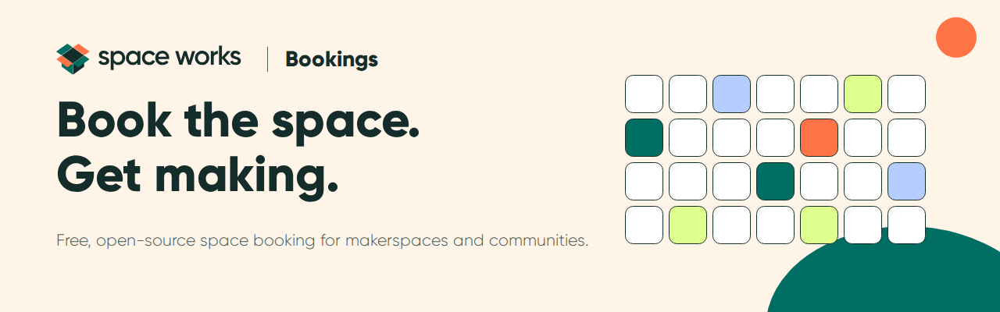
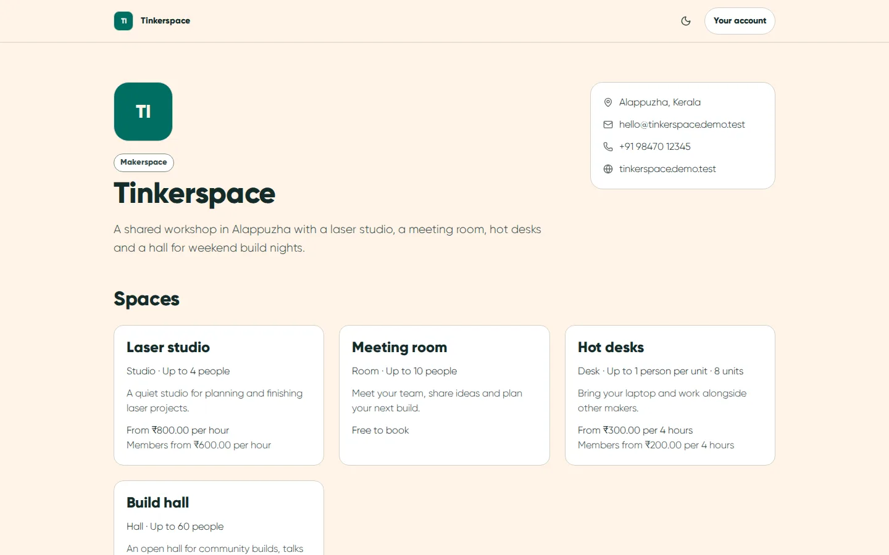
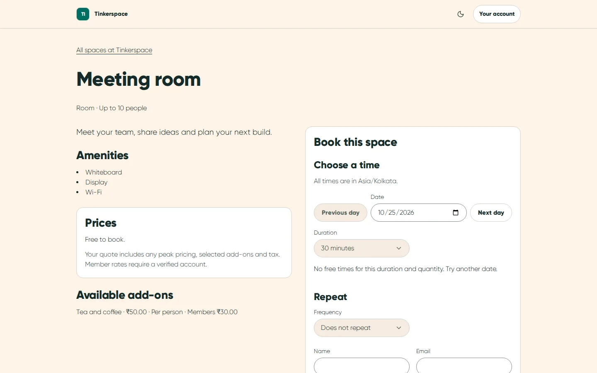
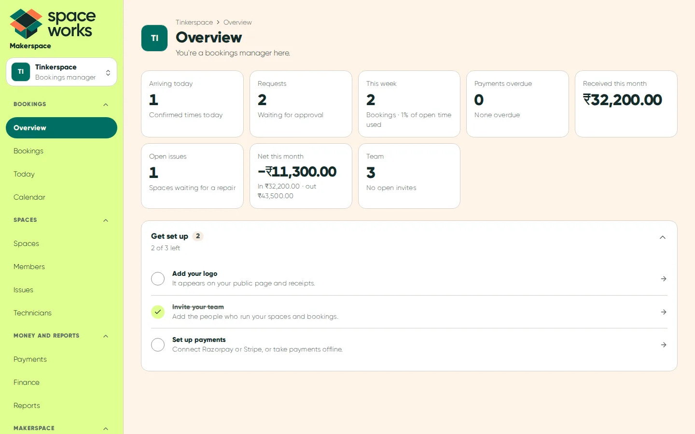
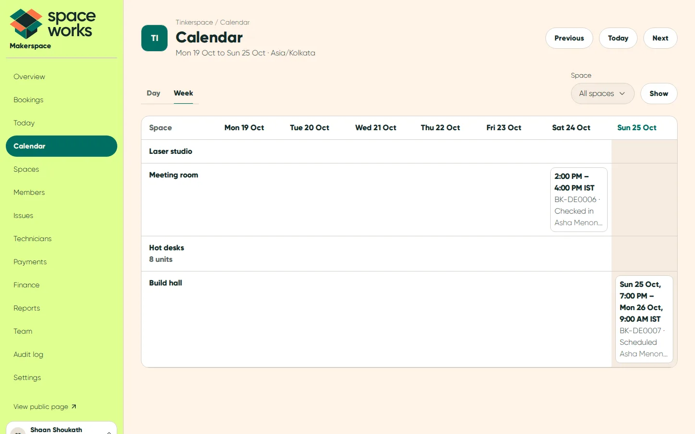
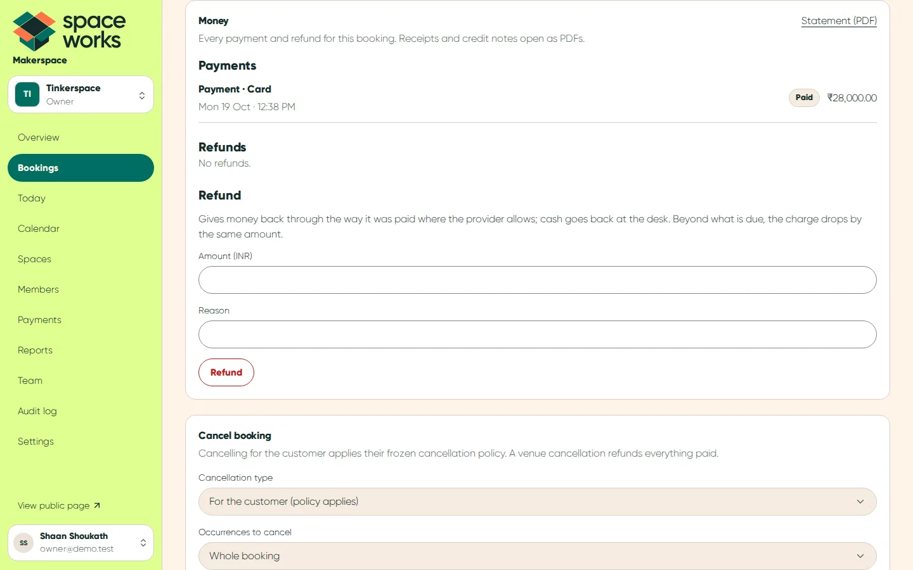
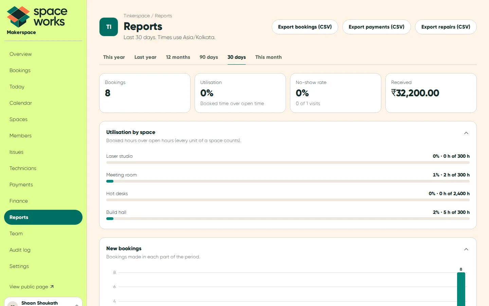
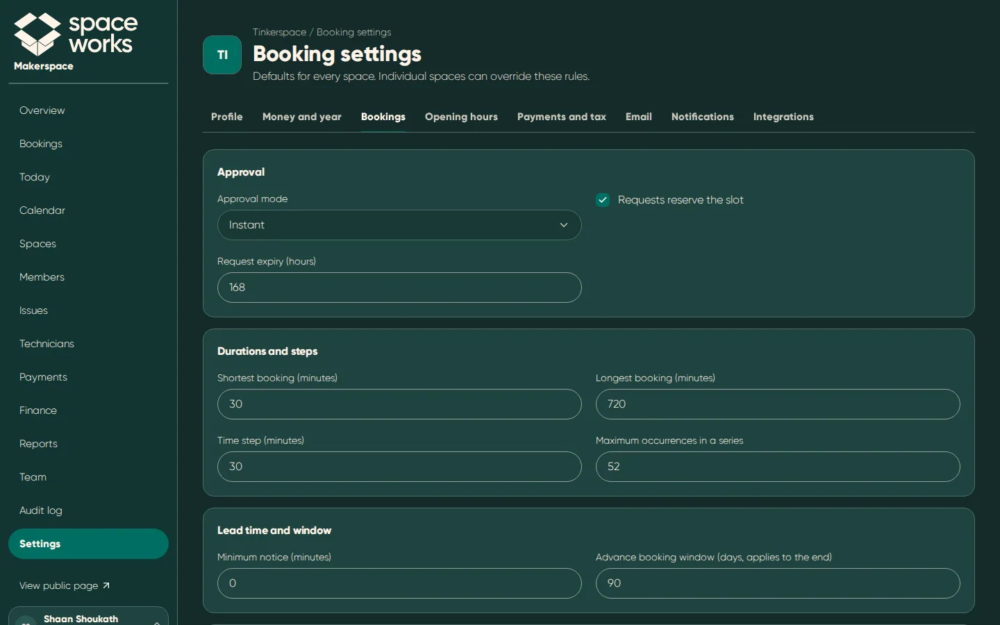
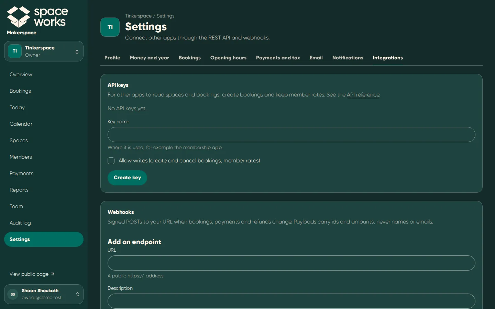

<picture>
  <source media="(prefers-color-scheme: dark)" srcset="docs/readme/banner-dark.png" />
  <source media="(prefers-color-scheme: light)" srcset="docs/readme/banner.png" />
  
</picture>

<p align="center">
  <a href="LICENSE"></a>
  <a href="https://nextjs.org"></a>
  <a href="#quick-start-local"></a>
  <a href="docs/DEPLOYMENT_CLOUD.md"></a>
</p>

<p align="center">
  <a href="#host-it-on-a-vps-with-docker">Host on a VPS</a> ·
  <a href="#run-it-in-the-cloud">Cloud hosting</a> ·
  <a href="#quick-start-local">Quick start</a> ·
  <a href="#documentation">Documentation</a> ·
  <a href="#contributing">Contributing</a> ·
  <a href="#credits">Credits</a>
</p>

**Space Works Bookings is a free, open-source booking system from Space Works for a makerspace's rooms, studios,
desks and halls.** Publish your spaces with their own hours, prices and rules, let members and guests book them
online, and run the front desk from a day sheet: approvals, check-in, no-shows and reschedules. Every booking can
be free or paid, with Razorpay, Stripe, payments at the desk or pay later, and refunds that follow your own
cancellation policy to the paisa. One self-hosted install runs several makerspaces, each with its own team, money
and branding, and your customers' data stays in your own database.

## What you can do

### Publish your spaces

- Rooms, studios, desks and halls, each with photos, capacity, amenities and any number of identical units (eight
  hot desks book as one space).
- Opening hours per makerspace or per space, holiday exceptions and blackouts; times stay right across daylight
  saving changes.
- Hourly, half-day and day rates, member rates, peak pricing and add-ons (per booking, per hour or per person), with
  GST inclusive or exclusive and a SAC per space.

### Take bookings

- A public page per makerspace and per space, with live availability, a quote that updates as you choose, and
  recurring bookings (daily or weekly) that list any clashes before you book.
- Free instant, free with approval, pay now, deposit and pay later (shown as payment pending with a due date), set
  once for the makerspace and overridden per space where needed.
- Holds keep a time while someone checks out, and two people can never get the same slot: the database refuses it.
- Every customer gets a private link to manage their booking: cancel, reschedule, add it to their calendar, pay and
  download a statement.

### Run the front desk

- A Today sheet with check-in by button or code, no-shows, and a calendar of every space by day or week.
- Staff bookings on behalf of a customer, approvals, moves between spaces and reschedules, with every change on the
  booking's timeline.
- Branded emails for each step with calendar invites, and personal and team calendar feeds.

### Take payments and give refunds

- Razorpay Checkout, Stripe Checkout, cash, UPI, bank transfer or pay later, with gapless receipts and credit notes.
- Refunds for every case: the cancellation policy's tiers, venue cancellations, cheaper reschedules, duplicate or
  late payments, refunds made in the provider's dashboard, failed refunds you retry or hand back by hand.
- A reconciliation page for open checkouts, payments to review and refunds still to finish.

### Know how it's going

- An overview of today's arrivals, requests, overdue payments and the week's bookings.
- Reports on utilisation per space, bookings, no-shows, money received and refunds, with audited CSV exports.
- An audit log of every settings, team, money and integration change.

### Connect your other tools

- A REST API with read and write keys, documented in OpenAPI.
- Signed webhooks for bookings, payments and refunds, with retries and a delivery log.

### Run it safely

- Email and password or a one-time sign-in link, authenticator codes for every member of staff, known devices,
  IP blocking and breached-password checks. No third-party sign-in and no trackers.
- Six roles (owner, space manager, bookings manager, front desk, treasurer, viewer); settings that touch money need
  the payments capability, and every settings change is audited.

## A look around

<table>
  <tr>
    <td width="50%" valign="top">
      
      <p><strong>Your public page.</strong> Every space, what it holds and what it costs.</p>
    </td>
    <td width="50%" valign="top">
      
      <p><strong>Book a space.</strong> Pick a day, a length and a start time.</p>
    </td>
  </tr>
  <tr>
    <td width="50%" valign="top">
      
      <p><strong>Overview.</strong> What needs you today.</p>
    </td>
    <td width="50%" valign="top">
      
      <p><strong>Calendar.</strong> Every space, every day of the week.</p>
    </td>
  </tr>
  <tr>
    <td width="50%" valign="top">
      
      <p><strong>Money on a booking.</strong> Payments, refunds, receipts and a statement.</p>
    </td>
    <td width="50%" valign="top">
      
      <p><strong>Reports.</strong> Utilisation, no-shows and money, with CSV exports.</p>
    </td>
  </tr>
  <tr>
    <td width="50%" valign="top">
      
      <p><strong>Booking rules, dark mode.</strong> Every rule a setting, nothing hard-coded.</p>
    </td>
    <td width="50%" valign="top">
      
      <p><strong>Integrations, dark mode.</strong> API keys and signed webhooks.</p>
    </td>
  </tr>
</table>

Every screen is captured in light and dark mode under [`docs/screenshots`](docs/screenshots), from the demo data
(`node scripts/capture-readme-screens.mjs`).

## Host it on a VPS with Docker

The complete application runs on your own server with Docker: the website and API, a background worker and its
scheduler, PostgreSQL, Redis and private file storage, behind Caddy with automatic HTTPS.

### Install in one line

```bash
curl -fsSL https://raw.githubusercontent.com/SpaceWorks-HQ/SpaceWorks-Bookings/main/install.sh | bash
```

While the repository is private, export a token (`repo`, `read:packages`) and pass it to curl, or use the GitHub
CLI:

```bash
curl -fsSL -H "Authorization: Bearer $GITHUB_TOKEN" https://raw.githubusercontent.com/SpaceWorks-HQ/SpaceWorks-Bookings/main/install.sh | bash
gh api -H 'Accept: application/vnd.github.raw' repos/SpaceWorks-HQ/SpaceWorks-Bookings/contents/install.sh | bash
```

The installer checks the machine, asks its questions before changing anything, and installs Docker if needed. Until
the first release is published, build a branch from source with `--ref main` (or `--ref dev`). `--dry-run` runs the
checks only; `--non-interactive` with `SWB_ANSWER_*` answers installs unattended
([docs/DEPLOYMENT_VPS.md](docs/DEPLOYMENT_VPS.md)).

### Update, back up and check

Run the installer again for its maintenance menu: update, status, backups, restore, rollback, settings, server
security, super-admin recovery, support bundle and uninstall. The same tools work on their own:

```bash
bash scripts/status.sh                                     # release, services, worker and beat health, newest backup
bash scripts/update.sh --force [--version V | --rollback]  # update, or roll back
bash scripts/backup.sh && bash scripts/restore.sh backups/<dump>.sql.gz [--with-storage]
bash scripts/admin.sh create --email you@example.org       # super admins are made on the server only
```

### Can the website live on Netlify and the backend on the VPS?

Yes. The website is a separate image that talks to the backend through a signed gateway and holds no database,
mail or storage credentials; background jobs always stay on the backend. See
[docs/DEPLOYMENT_NETLIFY.md](docs/DEPLOYMENT_NETLIFY.md).

## Run it in the cloud

[](https://render.com/deploy?repo=https://github.com/SpaceWorks-HQ/SpaceWorks-Bookings)

[`render.yaml`](render.yaml) creates a managed PostgreSQL database, the website and the background worker and
scheduler; bring a TLS Redis (for example Upstash), an S3-compatible bucket (for example Cloudflare R2) and SMTP.
Any Docker host with managed services works with [`docker-compose.cloud.yml`](docker-compose.cloud.yml), and
DigitalOcean App Platform with [`.do/app.yaml`](.do/app.yaml). Details in
[docs/DEPLOYMENT_CLOUD.md](docs/DEPLOYMENT_CLOUD.md).

## Quick start (local)

You need Node 22.9 or newer, Docker for PostgreSQL and Redis, and a terminal.

```bash
cp .env.example .env            # then fill in the secrets it asks for
docker compose up -d            # PostgreSQL and Redis for development
npm ci
npm run db:migrate
DEMO_PASSWORD=<12+ characters> DEMO_MFA_SECRET=<base32 seed> npm run db:seed-demo
npm run dev                     # http://localhost:3000
```

The demo makerspace is Tinkerspace (`/m/tinkerspace`) with four spaces, bookings and payments. Sign in as
`owner@demo.test` or `front@demo.test` with `DEMO_PASSWORD` and an authenticator code from `DEMO_MFA_SECRET`.
Without Redis, set `JOBS_INPROCESS=true` and leave `REDIS_URL` unset to run the background jobs inside `npm run dev`.

## Design system

Space Works Bookings follows [SpaceWorks-Design](https://spaceworks-hq.github.io/SpaceWorks-Design/): Gilroy,
pill-shaped controls, flat cards with 1px lines, light and dark mode for everything, and Patch, the Space Works
wolf, on a few staff screens and the 404 page ([docs/DESIGN.md](docs/DESIGN.md), including its easter eggs).

| | Colour | Hex | Used for |
| --- | --- | --- | --- |
|  | Deep Ink | `#142C2A` | Text, inverse surfaces, the dark mode ground |
|  | Warm Cream | `#FFF4E8` | The light mode ground, labels on teal |
|  | Maker Teal | `#006E63` | Primary actions, links and focus |
|  | Workshop Orange | `#FF7447` | One bold moment, with an ink label; never text |
|  | Citron | `#DFFF8F` | Success, the dashboard sidebar, selection |
|  | Sky Blue | `#B5CDFF` | Information |
|  | Warm Yellow | `#FFD447` | Warnings |

## Documentation

| Read this | When you want to |
| --- | --- |
| [Handoff](docs/HANDOFF.md) | Know what is done, what is decided and what is open |
| [Architecture](docs/ARCHITECTURE.md) | Understand request flows, data and background work |
| [Payments](docs/PAYMENTS.md) and [GST](docs/GST.md) | Follow money, refunds, receipts and tax |
| [REST API and webhooks](docs/API.md) | Connect another system |
| [Notifications](docs/NOTIFICATIONS.md) | See which emails and alerts go out, and when |
| [Security](docs/SECURITY.md) | Review sign-in, isolation and privacy |
| [Configuration](docs/CONFIGURATION.md) | Look up an environment variable |
| [VPS deployment](docs/DEPLOYMENT_VPS.md) | Install, operate and update on your own server |
| [Cloud deployment](docs/DEPLOYMENT_CLOUD.md) | Go live on Render, DigitalOcean or any Docker host |
| [Netlify website + server backend](docs/DEPLOYMENT_NETLIFY.md) | Split hosting |
| [Design](docs/DESIGN.md) | Apply the brand, Patch and the easter eggs |

## Common commands

```bash
npm run dev                  # development server
npm run lint                 # ESLint
npm run typecheck            # TypeScript
npm run test:unit            # unit tests
npm run test:integration     # PostgreSQL tests (TEST_DATABASE_URL, a disposable database)
npm run test:e2e             # browser tests against the seeded demo
npm run test:e2e:vps         # the whole production build in the browser
npm run build                # production build
npm run build:jobs           # the background worker and scheduler
```

## Contributing

Issues and pull requests are welcome. Branch from `dev` and open your pull request into `dev`; `main` is the
released branch. Before you open it, run lint, the type check and the unit and integration tests, and read
[`CLAUDE.md`](CLAUDE.md) (the same as [`AGENTS.md`](AGENTS.md)) for the conventions every change follows: tenancy,
roles, money, the 300-line file limit and the copy style. Write copy in British English, in sentence case.

## Credits

Space Works Bookings is built by the Space Works team. Its platform (accounts, multi-tenancy, payments, receipts,
outbox and operations) is forked from the
Space Works membership platform, its background worker comes from
[SpaceWorks-Workspace](https://github.com/SpaceWorks-HQ/SpaceWorks-Workspace), and parts of the platform from
[SpaceWorks-Events](https://github.com/SpaceWorks-HQ/SpaceWorks-Events). The booking and payment rules are ported from
the original [SpaceWorks](https://github.com/SpaceWorks-HQ/SpaceWorks) app. The name, logo, colours, fonts and Patch
come from [SpaceWorks-Design](https://spaceworks-hq.github.io/SpaceWorks-Design/). See [NOTICE](NOTICE).

## Licence

[GNU Affero General Public License v3.0 or later](LICENSE). If you run a modified version for others over a
network, you must offer them its source.
